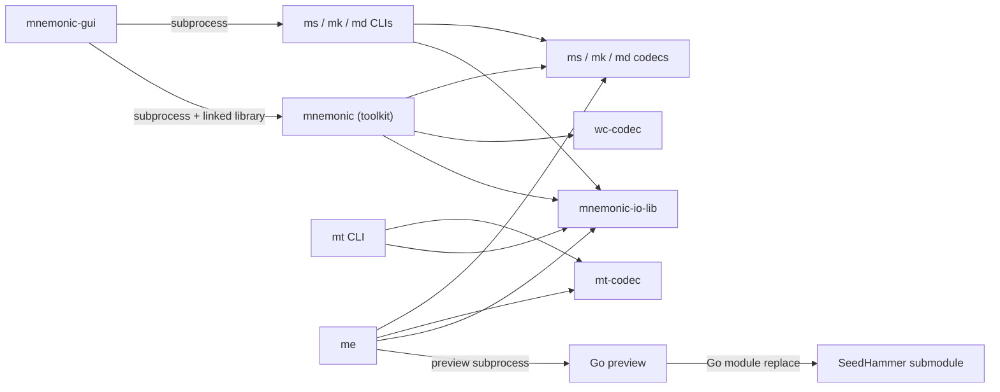

# Constellation architecture

An overview of how the m-format constellation is organised: what each repository
owns, how the repositories depend on one another, which invariants hold across them,
and where a change usually starts. It names no versions, revisions or counts, because
those change with every release; read manifests, lockfiles, CI definitions and the
specifications linked below for them. Where this guide and the code disagree, the
code and the specifications win.

**Scope.** The `ms1`, `mk1`, `md1` and `mt1` formats, public word cards, the
`mnemonic` toolkit, `me` host delivery and the `mnemonic-gui` front end. Refugium
(`mr1` cards and the desktop wallet) has
[its own guide](https://github.com/bg002h/mnemonic-refugium/tree/master/docs/architecture)
and consumes some of the same codecs. SeedHammer firmware internals have a separate owner.

## Repositories

| Repository | Packages (binary) | Owns |
| --- | --- | --- |
| [mnemonic-secret](https://github.com/bg002h/mnemonic-secret/tree/master/crates) | `ms-codec`; `ms-cli` (`ms`) | The `ms1` secret format: entropy, mnemonic and hashlock-preimage payloads, shares. CLI: secret and passphrase handling |
| [mnemonic-key](https://github.com/bg002h/mnemonic-key/tree/main/crates) | `mk-codec`; `mk-cli` (`mk`) | The `mk1` public-key card: origin, policy-ID stubs, chunk reconstruction. CLI: intake and derivation |
| [descriptor-mnemonic](https://github.com/bg002h/descriptor-mnemonic/tree/main/crates) | `md-codec`; `md-cli` (`md`); `xtask` | The `md1` descriptor card: serialization, identities, canonical origins, rendering. CLI: parsing and seating. `xtask` generates the verdict table from recorded evidence |
| [mnemonic-toolkit](../../crates) | `mnemonic-toolkit` (`mnemonic`); `wc-codec` | Multi-format bundle, restore, verify and repair workflows; wallet import and export; the public word-card engine; the manuals |
| [mnemonic-transaction](https://github.com/bg002h/mnemonic-transaction/tree/main/crates) | `mt-codec`; `mt-cli` (`mt`) | The `mt1` signed-transaction backup implementation. CLI: input validation, refusals, optional read-only node observations |
| [mnemonic-engrave](https://github.com/bg002h/mnemonic-engrave/tree/master/crates) | `mnemonic-engrave` (`me`); `mnemonic-io-lib`; Go `preview` | Host delivery: classification, NDEF, public bundles, sealed and systemwide containers, preview. Shared I/O mechanisms. The normative `mt1` specification and its independent vector generator |
| [mnemonic-gui](https://github.com/bg002h/mnemonic-gui/tree/master/src) | `mnemonic-gui` (`mnemonic-gui`, `gui-render`) | An egui front end that drives the `mnemonic`, `md`, `ms` and `mk` CLIs |

Codec crates own representations and format operations. CLIs own parsing, policy,
streams, diagnostics and exit codes. A crate directory is not always its package
name (`crates/me-cli` is the package `mnemonic-engrave`), so check the manifest
before choosing a package selector or assuming a CLI operation is a library API.

## Dependencies

Codec crates depend on no other constellation crate. Each CLI links its own codec
and `mnemonic-io-lib`, which supplies channel, file-descriptor, observation, record,
remedy, exit and write mechanisms. Callers keep classification, refusal and output policy, so sharing
it does not make exit codes or secret handling identical. Beyond that: `mk` also
links `md-codec`, `md` links `mk-codec`, the toolkit links the `ms`, `mk`, `md` and
word-card codecs, and `me` links the `ms`, `mk`, `md` and `mt` codecs.

Each consumer pins codecs on its own (registry version, git revision or vendored
source), so it may resolve a different codec than a sibling checkout builds. Read the
consumer's `Cargo.lock` and vendored sources before assuming an API or wire version
exists there. The `md-codec` revision in `me` is kept equal to Refugium's.

## Main flows

**Backup.** `mnemonic bundle` resolves a policy, per-slot keys or secret material,
origins and a network, then synthesizes related `ms1`, `mk1` and `md1` artifacts.
Full, watch-only, descriptor and multisig routes share machinery but carry different
material. The bundle JSON keeps a dense per-slot array in which an empty string marks
a watch-only slot; preserve slot order and that sentinel. Entry points: the toolkit's
`cmd/` subcommands, `synthesize` and `format`.

**What a card holds.** An `ms1` card holds a secret payload, not a wallet; a
passphrase stays a separate input. An `mk1` card holds an extended public key, its
origin and policy-ID stubs. An `md1` card holds a policy template, optionally with
sparse keys and origins; its payload is bytes plus an exact bit count. `Md1EncodingId`,
`WalletDescriptorTemplateId`, `WalletPolicyId` and `SkeletonKey` deliberately include
different information; none is a display string, and comparing them is not comparing
text.

**Recovery and verification.** `restore` turns secret seed material (or, for a
multisig cosigner, the shared `md1` card) into a watch-only document of descriptors
and first addresses, never private keys. `verify-bundle` re-derives expected card
content from a seed or a partial card set and reports per-card results. A valid
checksum or an applied correction (`repair`) is not that evidence. Rules that limit
minting a new artifact must not stop decoding or identifying an existing one.

**Word cards.** The toolkit's `word_card_adapter` converts canonical `mk1` and `md1`
payloads to `wc-codec`, which turns a source kind, payload bytes and exact bit length
into BIP-39 word sequences with error correction and RAID. Word cards are a transport
separate from seed phrases and own no descriptor policy.

**Signed transactions.** `mt` backs up an already signed transaction. `mt-codec`
holds the format; `mt-cli` handles input sniffing, validation, refusals and locktime
reporting, and may read a node through `bitcoin-cli`. Nothing broadcasts. `mt1`
strings and the QR transaction record reach `me`'s systemwide path, but `me bundle`
accepts only public `md1` and `mk1` input and refuses `ms1` and `mt1`.

**Host delivery.** `me` classifies and validates constellation input, builds NDEF
records and public bundles, and handles sealed and systemwide containers, which are
distinct formats. A public bundle decodes policy and origin data before it reports a
layout or plate count. Preview is a Go sidecar that the host locates, version-checks
and runs.

**GUI.** Forms assemble argv, a channel planner decides how each secret reaches the
child process, and a runner spawns the CLI. The form schema mirrors each CLI's
`gui-schema` output, and descriptor building parses JSON results, so a JSON change
can break the GUI without any flag changing. `pinned-upstream.toml` governs the CLI
schema expectations and the Cargo manifest separately pins the linked toolkit; check
both when changing either side. The toolkit's library
exports only selected utilities; its workflows stay binary-private.

## Invariants

- Rust is primary for normative codec behavior. The SeedHammer fork's Go
  reimplementations follow it, and a suspected Go-only defect is checked against
  the Rust code first.
- Test vectors come from a source independent of the implementation under test; a
  round trip is not identity or address evidence.
- `md`, `mk` and `mt` fork their BCH string layers rather than share a crate; a
  defect in one prompts checking the others.
- Checksum-valid, corrected, decoded and verified are four different claims.
- Consumers of a shared contract (the GUI, `me`, Refugium) change in lockstep with
  the owner; the owner row below names the coupled work.

## Where to change X

| Change | Primary owner | Coupled work |
| --- | --- | --- |
| Payload, chunking, correction or wire rule | The owning codec crate (`ms`, `mk`, `md`, `mt`, `wc`) | Specs, independent vectors, CLI admission and recovery, consumer pins, downstream Go ports |
| Descriptor identity, origins or rendering | `md-codec` identity, origin and render modules; `md-cli` | `mk` stubs, toolkit recovery, `me` admission, the shared Refugium pin |
| Bundle composition or JSON | Toolkit `cmd/bundle`, `synthesize`, `format` | Restore and verify contracts, GUI consumers, manuals |
| Public word-card transport | `wc-codec` and the toolkit `word_card_adapter` | Source-kind and bit-length contract, RAID and CLI tests |
| Transaction refusal or `mt1` format | `mt-cli` refusal and validation modules, `mt-codec`; `me` owns the spec | Independent `me` generator, copied provenance, systemwide transport |
| Delivery, container or shared I/O | `me` (`bundle`, `seal`, `sysw`, `ndef`, `preview`); `mnemonic-io-lib` | Each caller's policy, Go vectors, firmware handoff |
| CLI flags or structured output | Implementing CLI | Shared manual, GUI schema and JSON handling, binary pins |
| A user-facing verb that several formats share (repair first) | toolkit (`mnemonic`) | Per-format CLI removal and printed advice, [verb table](../manual/src/50-comparing/51-format-decision.md#which-tool-owns-which-verb), manual chapters, GUI schema |

## Specifications and further reading

- `ms1`: [SPEC_ms_v0_1.md](https://github.com/bg002h/mnemonic-secret/blob/master/design/SPEC_ms_v0_1.md).
- `mk1`: [BIP draft](https://github.com/bg002h/mnemonic-key/blob/main/bip/bip-mnemonic-key.mediawiki)
  and [SPEC_mk_v0_1.md](https://github.com/bg002h/mnemonic-key/blob/main/design/SPEC_mk_v0_1.md).
- `md1`: [BIP draft](https://github.com/bg002h/descriptor-mnemonic/blob/main/bip/bip-mnemonic-descriptor.mediawiki).
  The wire-version-8 design, [SPEC_liana_unspendable_internal_key.md](https://github.com/bg002h/mnemonic-engrave/blob/master/design/SPEC_liana_unspendable_internal_key.md),
  is hosted in `me`; `md` owns its implementation.
- `mt1`: [SPEC_mt_v0_1.md](https://github.com/bg002h/mnemonic-engrave/blob/master/design/SPEC_mt_v0_1.md)
  in `me`, with [vectors](https://github.com/bg002h/mnemonic-engrave/tree/master/design/vectors); copies in
  [mnemonic-transaction](https://github.com/bg002h/mnemonic-transaction/blob/main/design/PROVENANCE.md) record their provenance.
- `me` delivery: [systemwide payloads](https://github.com/bg002h/mnemonic-engrave/blob/master/design/SPEC_systemwide_payloads.md),
  [encrypted delivery](https://github.com/bg002h/mnemonic-engrave/blob/master/design/SPEC_encrypted_payload_delivery.md),
  [descriptor input](https://github.com/bg002h/mnemonic-engrave/blob/master/design/SPEC_descriptor_input.md).
- Toolkit: [design specifications](../../design), the [user manual](../manual/README.md),
  [technical manual](../technical-manual/README.md) and [GUI manual](../manual-gui/README.md).
- Process and instruction loading: each repository's `AGENTS.md` and `CLAUDE.md`.

## Keeping this guide useful

Update it when an owner, a dependency edge or an invariant changes, not for releases.
Put questions not yet decided in [OPEN_QUESTIONS.md](OPEN_QUESTIONS.md). Check links
with `python3 docs/architecture/check.py`; it validates paths, not claims, so review
the diagram and owner table against the manifests when editing them.
