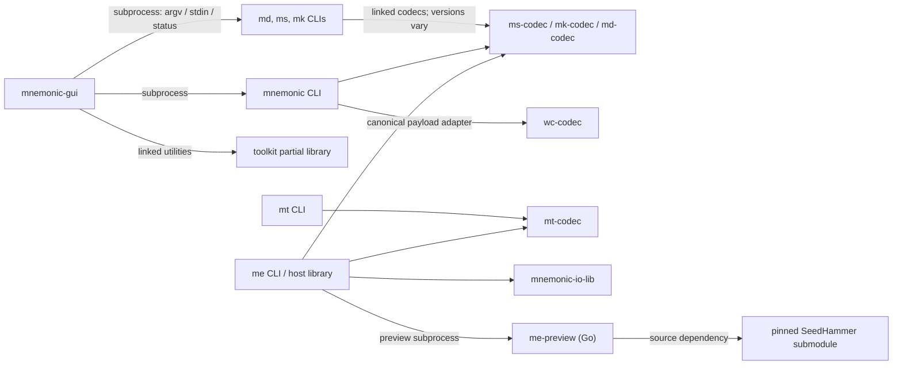

# Constellation architecture

This is a developer navigation guide for the source snapshot recorded on **2026-10-30**.
It explains ownership, data flow, and compatibility boundaries. Start here, then use
[SOURCE_MAP.md](SOURCE_MAP.md) for implementation, specification, and test anchors.
The [inventory](inventory.json) records checkout commits separately from each consumer's
resolved dependencies. It is a dated snapshot, not a claim about every installed release.

The scope is `ms`, `mk`, `md`, `mnemonic`, `mt`, `me`, shared packages, and the
utility GUI `mnemonic-gui`. Refugium is included only where shared dependencies matter.
Refugium wallet behavior, `mr-gui`, and SeedHammer firmware internals have separate owners.
The firmware mapping belongs under `mnemonic-engrave/design/firmware-architecture/`;
that handoff does not make the host guide a hardware validation record.

## Repositories and layers

| Repository | Packages / entry points | Responsibility |
| --- | --- | --- |
| mnemonic-secret | ms-codec; ms-cli → ms | Secret payload encoding, recovery, shares, hashlock primitives; CLI mnemonic and passphrase handling |
| mnemonic-key | mk-codec; mk-cli → mk | Public extended-key cards, origins, policy stubs, chunk reconstruction; CLI intake and derivation |
| descriptor-mnemonic | md-codec; md-cli → md; xtask | Descriptor serialization, identities, composition/rendering; CLI parsing and seating; verdict-table generation from recorded coordinator evidence |
| mnemonic-toolkit | mnemonic-toolkit → mnemonic; wc-codec | Multi-format bundle/recovery workflows and selected reusable utilities; public word-card transport |
| mnemonic-transaction | mt-codec; mt-cli → mt | Signed-transaction backup format; CLI refusal policy and optional node observations |
| mnemonic-engrave | mnemonic-engrave → me; mnemonic-io-lib; Go preview | Host delivery, containers, public bundles and preview; reusable I/O mechanisms |
| mnemonic-gui | mnemonic-gui; gui-render | Utility GUI that drives four CLIs and links a limited toolkit library surface |

The codec crates own representations and format operations. Their CLIs own parsing,
operational policy, streams, diagnostics, and user choices. A crate directory is not
necessarily its package name: `crates/me-cli` is package `mnemonic-engrave`, exposing
library `mnemonic_engrave` and binary `me`. Inspect the manifest before choosing a
package selector or assuming a CLI operation is a library API.

This diagram selects the main integration edges; the source map records the exact pins.

`mnemonic-io-lib` is also consumed by constellation CLIs. It supplies channel, file
descriptor, observation, record, remedy, exit, and write mechanisms; callers retain
classification, refusal and output policy. Sharing this crate does not make every
CLI's exit semantics or secret policy identical. See its
[explicit ownership boundary](https://github.com/bg002h/mnemonic-engrave/blob/a75719996304086e5f293aaf26812ff242a25244/crates/mnemonic-io-lib/src/lib.rs).

## Follow a backup and recovery

A toolkit bundle begins in [cmd/bundle.rs](https://github.com/bg002h/mnemonic-toolkit/blob/ef99021a26f733594ca6b711b9d3b82a494f39b1/crates/mnemonic-toolkit/src/cmd/bundle.rs).
Input resolution and [synthesis](https://github.com/bg002h/mnemonic-toolkit/blob/ef99021a26f733594ca6b711b9d3b82a494f39b1/crates/mnemonic-toolkit/src/synthesize.rs)
combine the requested policy, per-slot keys or secret material, origins, and network
into related `ms1`, `mk1`, and `md1` artifacts. Full, watch-only, descriptor and
multisig routes share machinery but carry different available material. Preserve slot
ordering and missing-material semantics across them: the
[JSON types](https://github.com/bg002h/mnemonic-toolkit/blob/ef99021a26f733594ca6b711b9d3b82a494f39b1/crates/mnemonic-toolkit/src/format.rs) use a dense secret-slot
array with an empty watch-only sentinel, while the key field distinguishes a single
key's strings from nested multisig sets.

The secret card does not contain the whole wallet. `Entr` stores entropy without a
wordlist language; `Mnem` carries language with entropy. A separately supplied
passphrase remains a separate input to derivation. The current ms checkout also
supports `Preimage`, which must not be treated as a mnemonic. Toolkit's resolved
older ms-codec only has the entropy/mnemonic variants; do not infer preimage support
there from the sibling checkout. The codec owns payload reconstruction, while the
CLI owns the interpretation needed for mnemonic derivation.

A key card carries the public extended key, origin path, optional fingerprint, and
policy-ID stubs. Compact xpub reconstruction depends on agreement between the path
and omitted header information. Stubs help associate material; the information in a
sparse descriptor cannot establish every membership claim. Follow
[KeyCard](https://github.com/bg002h/mnemonic-key/blob/bdb1df7f61e4eef94509e589a5d7b0d1f626cfd6/crates/mk-codec/src/key_card.rs) and
[CLI membership checks](https://github.com/bg002h/mnemonic-key/blob/bdb1df7f61e4eef94509e589a5d7b0d1f626cfd6/crates/mk-cli/src/cmd/encode.rs)
when changing how origins or keys enter a bundle.

A descriptor card describes policy and may carry sparse key/origin information.
Its canonical payload includes **bytes and an exact bit count**. Distinguish
`Md1EncodingId`, `WalletDescriptorTemplateId`, `WalletPolicyId`, and `SkeletonKey`:
they intentionally include or omit different information. A shape key is not a
wallet identity, and identity comparison must not silently become equality of
display strings. The [identity module](https://github.com/bg002h/descriptor-mnemonic/blob/5dfb1fde7dccf3664c6547b065169717452e00ae/crates/md-codec/src/identity.rs)
is the implementation anchor.

Recovery starts in [restore](https://github.com/bg002h/mnemonic-toolkit/blob/ef99021a26f733594ca6b711b9d3b82a494f39b1/crates/mnemonic-toolkit/src/cmd/restore.rs);
descriptor seating additionally lives in the md CLI. Reassemble complete chunk sets,
preserve origins and language, and distinguish missing information from invalid
information. Current md decoding permits partial origins only through its explicit
option. Restrictions on minting a new artifact must not accidentally prevent
decoding or identifying an existing one; see
[the admission/recovery regression](https://github.com/bg002h/descriptor-mnemonic/blob/5dfb1fde7dccf3664c6547b065169717452e00ae/crates/md-codec/tests/mint_policy_does_not_reach_decode.rs).

Verification must establish the intended relationship between recovered material
and the wallet. [verify-bundle](https://github.com/bg002h/mnemonic-toolkit/blob/ef99021a26f733594ca6b711b9d3b82a494f39b1/crates/mnemonic-toolkit/src/cmd/verify_bundle.rs)
re-synthesizes from supplied ground truth and compares structured material.
A valid checksum or successful correction alone is not that evidence. The ms repair
CLI explicitly reports an applied correction as an unverified candidate. When
changing recovery, retain independent identity/address checks and the existing
forensics/refusal tests, rather than treating a codec round trip as sufficient.

## Public word cards and signed transactions

Toolkit's [word-card adapter](https://github.com/bg002h/mnemonic-toolkit/blob/ef99021a26f733594ca6b711b9d3b82a494f39b1/crates/mnemonic-toolkit/src/word_card_adapter.rs)
bridges canonical mk/md payloads to `wc-codec`. The engine works with bytes, bit
lengths, framing, and recovery/RAID operations; it does not own descriptor policy.
These public word cards are a separate transport from mnemonic seed phrases.
Changing an adapter requires keeping the source kind and md bit length intact.
Existing word-card and backup/restore tests are listed in the source map.

`mt` backs up an already signed transaction. The codec contains the format; CLI
modules handle input sniffing, validation, refusal reporting, locktime information,
and optional read-only `bitcoin-cli` observations. The node adapter does not
broadcast. Binary PSBT detection precedes whitespace cleanup, so changing input
normalization can change which refusal an input reaches.

The two handoff forms are `mt1` strings and the CLI's QR `tx:` transaction-hex
record. Both relate to me's systemwide delivery path. They do **not** become public
wallet bundles: `me bundle` accepts md/mk and explicitly refuses ms/mt.
The normative mt specification and independent vector generator live in
mnemonic-engrave; mnemonic-transaction's design copies have recorded provenance.
Change the owner, then update the copies and corpus. The
[provenance record](https://github.com/bg002h/mnemonic-transaction/blob/56886b826d1c47fdf7ee8246a4a78f5b768bae2d/design/PROVENANCE.md) also explains that the BCH
port comes from mk-codec and why sibling implementations must be checked together.

## Host delivery and firmware boundary

The me library classifies and validates constellation input, converts admitted text
to NDEF, constructs public bundles, handles sealed and systemwide containers, and
supports preview. CLI stream selection, final output and operator reporting live in
`main.rs`. `seal` and `sysw` are distinct container formats despite reusing some
cryptographic/passphrase machinery. The systemwide record model distinguishes
secret-bearing and bearer material; signed transactions must not inherit policy
merely because they are not mnemonic seeds.

Public bundle construction must decode supported policy and origin data before
reporting a layout or plate count. See
[bundle admission](https://github.com/bg002h/mnemonic-engrave/blob/a75719996304086e5f293aaf26812ff242a25244/crates/me-cli/src/bundle.rs) and
[systemwide record classes](https://github.com/bg002h/mnemonic-engrave/blob/a75719996304086e5f293aaf26812ff242a25244/crates/me-cli/src/sysw/record.rs).
Preview is a Go sidecar: the host locates an explicitly selected executable or one
beside itself, checks its version, then validates the output artifact.
`preview/go.mod` uses the pinned `third_party/seedhammer` source.
A preview image is not proof of successful engraving or device-side admission.

The firmware handoff is the relevant format specification, Rust implementation,
vectors, and dependency/provenance pin. Existing project policy makes Rust the
primary implementation for shared normative codec behavior. A Go convergence fix
still requires checking the Rust counterpart. Gemini owns the device call graph,
hardware behavior, and firmware initialization file; this guide stops at that
boundary.

## Utility GUI and shared-library boundaries

`mnemonic-gui` is the egui utility front end, separate from Refugium's GUI.
[CliTab](https://github.com/bg002h/mnemonic-gui/blob/46e1c0f31b5688c447309fdae3bcb439c43f7e4a/src/app.rs) selects mnemonic/md/ms/mk, forms construct a
RunPlan, and [the runner](https://github.com/bg002h/mnemonic-gui/blob/46e1c0f31b5688c447309fdae3bcb439c43f7e4a/src/runner.rs) invokes subprocesses.
It also links the toolkit library for selected utilities such as secret taxonomy.
Toolkit's [lib.rs](https://github.com/bg002h/mnemonic-toolkit/blob/ef99021a26f733594ca6b711b9d3b82a494f39b1/crates/mnemonic-toolkit/src/lib.rs) does not export
the complete CLI implementation; many workflow modules remain binary-private.

The GUI consumes structured output for descriptor building, including emitted
specifications and validation results. Consequently a JSON change may break the GUI
without changing any flag. `pinned-upstream.toml` governs its CLI schema expectations;
the Cargo manifest/lock separately govern its linked toolkit version. Check both
when changing either side, and update the GUI manual as needed.

Refugium and me align on a shared md-codec revision. That is a dependency coordination
boundary, not evidence that the inspected Refugium GUI currently links the me library.
The source map records the narrow manifest inspection; broader wallet architecture
is outside this guide.

## Compatibility and change ownership

Checkout version, resolved library version, wire version, CLI release tag, and the
`1` separator in a string are different concepts. At this snapshot, toolkit resolves
ms-codec 0.7.0, mk-codec 0.4.1 and md-codec 0.47.0; sibling checkouts declare 0.10.0,
0.5.0 and 0.48.4. The older mk encoder uses random string framing; mk0.5 derives a
content ID. Compare canonical payloads when exact strings are not the contract.

A concrete compatibility limit: mk CLI resolves md-codec 0.42.0, whose decoder accepts
wire version 4 only. Current md and toolkit's md0.47 accept 4 and 8. A new descriptor
card therefore does not automatically work in every sibling CLI. Inspect consumer
lockfiles and vendored code before promising interoperability.

| Change | Primary owner | Coupled work |
| --- | --- | --- |
| Payload, chunking, correction or wire rule | Owning codec | Specs, independent vectors, CLI admission/recovery, consumer pins, downstream Go |
| Descriptor identity, origins or rendering | md-codec / md-cli | mk stubs, toolkit recovery, me admission, shared Refugium pin |
| Bundle composition or JSON | toolkit | Restore/verify contracts, utility GUI consumers, manuals |
| Public word-card transport | wc-codec + toolkit adapter | Source-kind/bit-length contract, RAID and CLI tests |
| Transaction refusal or mt1 format | mt-cli / mt-codec; me owns spec | Independent me generator, copied provenance, sysw transport |
| Delivery/container or shared I/O | me / mnemonic-io-lib | Each caller's policy, Go vectors, firmware handoff |
| CLI flags or structured output | Implementing CLI | Shared manual, GUI schema/JSON handling and binary pins |

Consumer pin changes include manifest, lockfile, vendoring/source-replacement
configuration, and provenance checks. The miniscript patch is an upstream Git
revision; a nearby historical fork checkout is not the active dependency by default.
Use existing CI definitions for toolchains and checks, not old test counts in prose.

## Keeping this useful

Read [WORKFLOW.md](WORKFLOW.md) and the target repository's AGENTS/CLAUDE files before
implementation. Use the [user manual](../manual/README.md),
[technical manual](../technical-manual/README.md), and
[GUI manual](../manual-gui/README.md) for their detailed reference material.
This guide records source-observed structure; specifications describe intended
contracts. [OPEN_QUESTIONS.md](OPEN_QUESTIONS.md) tracks known mismatches.

Update the affected flow and owner row with a contract change. Refresh the inventory
deliberately when revising the baseline; keep full revisions and provenance evidence.
The [documentation checker](check.py) validates local references and the recorded
snapshot. Review the dependency diagram and claims independently: a passing static
check cannot prove their semantics. Source inspection establishes neither consensus
conformance, secret erasure, hardware behavior, nor a passing runtime test suite.
